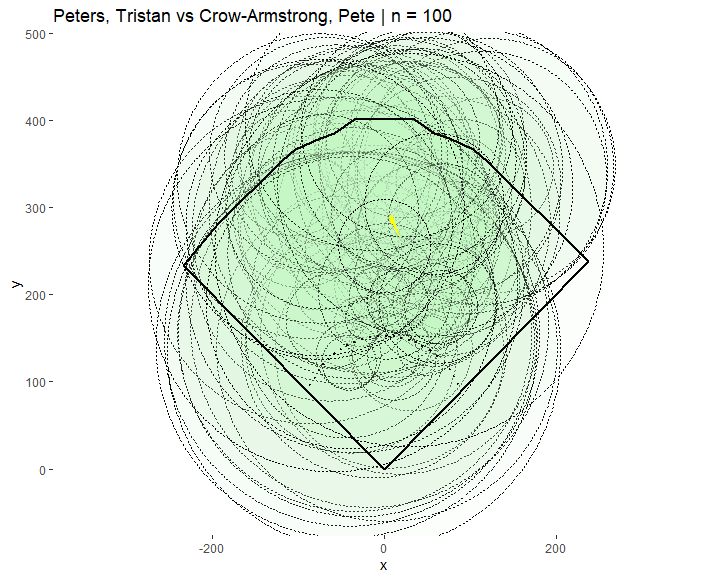

```{r, include = FALSE}
knitr::opts_chunk$set(
  collapse = TRUE,
  comment = "#>"
)
```

outfieldr is an R package that finds optimal outfielder positioning given a set of fielders and a batter. It is currently in development, but is functional. This vignette assumes a base familiarity with the R language -- if you are unfamiliar with RStudio or the language's syntax, I recommend [James Scott's *Data Science in R: A Gentle Introduction*](https://bookdown.org/jgscott/DSGI/getting-started-in-r.html) as it is thorough, online, and free to read.

## Install outfieldr

outfieldr can currently be installed in any R instance via devtools:

``` r
install.packages('devtools')
devtools::install_github(repo = "larrry27/outfieldr")
```

Once the package is installed, any of its functions can be used.

## Optimal Positioning Algorithm

The algorithm to calculate optimal outfielder positioning takes the last *n* batted balls by a hitter per field region (left, center, right). Each ball has their own ***catchable radius*** for a given fielder, determined by their sprint speed and outfielder jump statistics from [Baseball Savant](https://baseballsavant.mlb.com/). The center of the area, also called the ***optimal hull***, with the most overlap of the circles created by these balls and their catch radii constitutes optimal positioning for an outfielder versus that batter, as it allows them to catch the most balls. There are a few assumptions used:

1.  **The left and right fielders do not consider balls within the spray angles covered by center field.** This is currently π/9 in either direction.
2.  **A catch is made if an outfielder reaches the batted ball location within .4 seconds of it hitting the ground.**
3.  **Balls are not considered if they do not land within fair territory of the chosen park.** At this time, this prevents home run robberies and outs in foul territory.

## Examples

### `getBattedBallData`
``` r
# Get Chase Meidroth's last 200 batted balls in 2026, with Rate Field as the boundary.
getBattedBallData(805367,2026,200,11)
```
``` r
# ── MLB Baseball Savant Statcast Search data from baseballsavant.mlb.com ─────────────────────────────────────────────── # baseballr 2.0.0 ──
# ℹ Data updated: 2026-11-22 00:00:05 CST
# # A tibble: 191 × 14
#     hc_x  hc_y hit_distance_sc game_date  launch_speed launch_angle events    player_name   sprayAngle    t_x   t_y region inPark hangTime
#    <dbl> <dbl>           <dbl> <date>            <dbl>        <dbl> <chr>     <chr>              <dbl>  <dbl> <dbl>  <dbl>  <int>    <dbl>
#  1  74.3 124.              228 2026-10-08         88.8           18 double    Meidroth, Ch…    -0.601  -129.   188.      1      1     2.50
#  2 131.   98.2             202 2026-10-05         89.5           15 single    Meidroth, Ch…     0.0553   11.2  202.      2      1     2.11
#  3 184.  132.              187 2026-10-05         72.5           20 single    Meidroth, Ch…     0.724   124.   140.      3      1     2.26
#  4 107.  109.              230 2026-10-03         92.8           53 field_out Meidroth, Ch…    -0.207   -47.2  225.      2      1     6.76
#  5  99.6 109.              228 2026-09-30         89.7           15 single    Meidroth, Ch…    -0.283   -63.6  219.      2      1     2.12
#  6 101.  163.              143 2026-09-29        103.             8 field_out Meidroth, Ch…    -0.604   -81.2  118.      1      1     1.30
#  7  42.9 102.              165 2026-09-26        101.            10 double    Meidroth, Ch…    -0.708  -107.   125.      1      1     1.59
#  8  44   106               189 2026-09-23         93.3           15 single    Meidroth, Ch…    -0.723  -125.   142.      1      1     2.20
#  9  93.9 101.              205 2026-09-22         82.7           18 single    Meidroth, Ch…    -0.313   -63.1  195.      2      1     2.33
# 10 108.  154.              154 2026-09-20         97.1           11 field_out Meidroth, Ch…    -0.377   -56.7  143.      1      1     1.69
# ℹ 181 more rows
# ℹ Use `print(n = ...)` to see more rows
```

Returns a data frame containing relevant batted balls. `hc_x` and `hc_y` are coordinates provided by Statcast, which are transformed into calculated coordinates based on spray angle and launch angle where the back of home plate is (0,0).

### `getFielderStats`
``` r
# Get Tristan Peters' fielding stats in 2026.
getFielderStats(671976, 2026)
```
``` r
# ── MLB Baseball Savant Statcast Leaderboards data from baseballsavant.mlb.com ───────────────────────────────────────── baseballr 2.0.0 ──
# ℹ Data updated: 2026-11-22 00:02:16 CST
# # A tibble: 1 × 9
#   year.x last_name..first_name player_id position sprint_speed rel_league_burst_dist…¹ rel_league_reaction_…² rel_league_routing_d…³  jump
#    <dbl> <chr>                     <int> <chr>           <dbl>                   <dbl>                  <dbl>                  <dbl> <dbl>
# 1   2026 Peters, Tristan          671976 CF               28.7                     1.4                   -0.2                    0.8     2
# # ℹ abbreviated names: ¹​rel_league_burst_distance, ²​rel_league_reaction_distance, ³​rel_league_routing_distance
```

Returns fielding statistics for a chosen outfielder, which helps determine catch radius for batted balls.

### `optimizeOutfield`
``` r
# Find the optimal outfielder positioning versus Pete Crow-Armstrong at Rate Field in 2026:
optimizeOutfield(691718,803011,671976,695731,250,2026,11)
```

The above function outputs three plots, one for each fielder, alongside a print statement showing the centroid of the optimal hull and the split of balls analyzed. Each circle on the plot represents a batted ball and its catchable radius, while the yellow area represents the optimal hull.

{width="600"}
